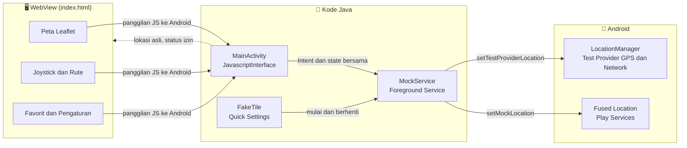
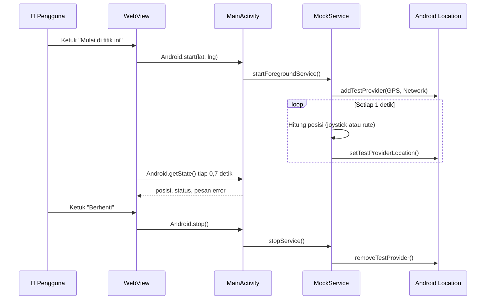
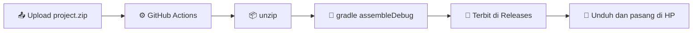

<div align="center">

# 📍 Pindah GPS

**Aplikasi lokasi palsu (Fake GPS) untuk Android, dibangun dan di-build sepenuhnya dari smartphone.**


[✨ Fitur](#-fitur) • [🚀 Mulai Cepat](#-mulai-cepat) • [📖 Cara Pakai](#-cara-pakai) • [🏗️ Arsitektur](#️-arsitektur) • [🛠️ Build](#️-build-lewat-github-actions) • [❓ FAQ](#-faq) • [🩺 Pemecahan Masalah](#-pemecahan-masalah)

</div>

---

## 📑 Daftar Isi

- [🌟 Tentang Proyek](#-tentang-proyek)
- [✨ Fitur](#-fitur)
- [🚀 Mulai Cepat](#-mulai-cepat)
- [📖 Cara Pakai](#-cara-pakai)
- [🏗️ Arsitektur](#️-arsitektur)
- [🗂️ Struktur Proyek](#️-struktur-proyek)
- [🔐 Izin yang Dipakai](#-izin-yang-dipakai)
- [🛠️ Build lewat GitHub Actions](#️-build-lewat-github-actions)
- [🔄 Cara Memperbarui](#-cara-memperbarui)
- [🧪 Status Pengujian](#-status-pengujian)
- [❓ FAQ](#-faq)
- [🩺 Pemecahan Masalah](#-pemecahan-masalah)
- [🗺️ Roadmap](#️-roadmap)
- [⚖️ Penggunaan yang Bertanggung Jawab](#️-penggunaan-yang-bertanggung-jawab)
- [🙏 Kredit](#-kredit)
- [📄 Lisensi](#-lisensi)

---

## 🌟 Tentang Proyek

**Pindah GPS** memungkinkan kamu mengganti lokasi yang dilaporkan perangkat Android memakai fitur resmi **"Pilih aplikasi lokasi palsu"** di *Opsi Developer*. Aplikasi ini **tidak butuh root** dan tidak memodifikasi sistem. Ia hanya menjadi *mock location provider* yang diizinkan Android.

Proyek ini punya satu ciri khas: **seluruhnya dikerjakan tanpa PC**. Kode ditulis, di-upload, dan di-build memakai smartphone dan GitHub Actions.

> [!NOTE]
> Aplikasi ini adalah aplikasi Android native (APK). Antarmukanya berupa halaman web (HTML, CSS, JavaScript, dan peta Leaflet) yang dimuat di dalam `WebView`, sedangkan pengiriman lokasi palsu dikerjakan oleh `Service` Java.

### 🎯 Kegunaan yang Wajar

| Skenario | Contoh |
|---|---|
| 🧪 **Pengujian aplikasi** | Menguji fitur berbasis lokasi tanpa harus berpindah tempat |
| 🔒 **Privasi** | Tidak membagikan lokasi asli ke aplikasi yang tidak perlu |
| 🧭 **Pengembangan** | Mensimulasikan perjalanan, rute, dan kecepatan |
| 🎓 **Belajar** | Memahami cara kerja *mock location* di Android |

---

## ✨ Fitur

### 📍 Lokasi

- [x] **Mulai di lokasi asli perangkat** (bukan lokasi bawaan tertentu)
- [x] **Cari tempat** lewat nama, misal *Monas*, lalu peta langsung berpindah
- [x] **Pilih titik di peta** dengan satu ketukan
- [x] **Input koordinat manual**, bisa langsung tempel dari Google Maps (`-6.175392, 106.827153`)
- [x] Tombol **Lokasi asli saya** untuk kembali ke posisi sebenarnya

### 🛣️ Rute Otomatis

- [x] Tandai beberapa titik di peta dan posisi akan **berjalan menyusurinya**
- [x] Tiga pola: **sekali jalan**, **bolak-balik**, dan **berputar**
- [x] Kecepatan bisa diubah **saat rute berjalan**
- [x] Info jumlah titik dan total jarak (km)

### 🕹️ Gerak Manual

- [x] **Joystick** virtual untuk mengatur arah dan kecepatan
- [x] Kecepatan **1 sampai 120 km/jam** dengan preset *Jalan, Lari, Sepeda, Motor*
- [x] Mode **lanjut berjalan otomatis** setelah joystick dilepas

### ⭐ Favorit

- [x] Simpan titik dengan nama sendiri
- [x] Pilih ulang dengan satu ketukan, bahkan saat lokasi palsu sedang aktif

### 🎭 Realisme

- [x] **Gerakan natural**: akurasi dan kecepatan sedikit bervariasi, dengan derau posisi sekitar 1 meter
- [x] Mengirim lokasi ke provider **GPS**, **Network**, dan **Fused** (Google Play Services)

### 🧰 Kenyamanan

- [x] **Tema** terang, gelap, atau otomatis mengikuti sistem
- [x] **Notifikasi** dengan tombol **Berhenti**
- [x] **Ubin Panel Cepat** (*Quick Settings*) untuk mulai dan berhenti tanpa membuka app
- [x] **Cek status otomatis** dengan banner peringatan bila ada yang belum siap
- [x] **Ikon dan nama** sendiri

---

## 🚀 Mulai Cepat

> [!TIP]
> Cara termudah: unduh APK dari tab [**Releases**](../../releases) repositori ini, lalu lewati langsung ke langkah 3.

### 1️⃣ Unduh APK

Buka tab **Releases** dan unduh `PindahGPS.apk` dari build terbaru. Belum ada build? Lihat bagian [Build lewat GitHub Actions](#️-build-lewat-github-actions).

### 2️⃣ Pasang

Izinkan pemasangan dari sumber tidak dikenal untuk browser atau pengelola file yang kamu pakai, lalu ketuk file APK.

> [!WARNING]
> Jika sebelumnya sudah ada versi lama yang dipasang dari build dengan kunci penandatangan berbeda, **hapus dulu** versi lama. Android menolak pembaruan bila tanda tangannya berbeda.

### 3️⃣ Aktifkan Opsi Developer

1. Buka **Pengaturan → Tentang ponsel**
2. Ketuk **Nomor build** sebanyak **7 kali**
3. Kembali ke Pengaturan, buka **Opsi developer** (biasanya di *Sistem* atau *Pengaturan tambahan*)

### 4️⃣ Pilih Sebagai Aplikasi Lokasi Palsu

Di Opsi developer, cari **Pilih aplikasi lokasi palsu** (*Select mock location app*), lalu pilih **Pindah GPS**.

### 5️⃣ Izinkan Izin yang Diminta

Saat pertama dibuka, izinkan **Lokasi** dan **Notifikasi**.

### 6️⃣ Mulai 🎉

Pilih titik di peta lalu ketuk **Mulai di titik ini**.

---

## 📖 Cara Pakai

Aplikasi punya lima tab di bagian bawah layar.

<details>
<summary><b>📍 Tab Lokasi</b></summary>

<br>

- **Cari tempat**: ketik nama lalu ketuk **Cari**, kemudian pilih hasilnya.
- **Koordinat**: isi *lintang* dan *bujur*. Boleh tempel format `lat, lng` ke kolom lintang, maka keduanya terisi otomatis.
- **Tampilkan di peta**: memindahkan peta dan penanda ke koordinat tersebut.
- **Lokasi asli saya**: mengambil kembali posisi sebenarnya. Hentikan lokasi palsu terlebih dahulu.
- Tombol utama **Mulai di titik ini** mengaktifkan lokasi palsu. Saat sudah aktif, tombolnya berubah menjadi **Pindah ke titik ini** dan ada tombol **Berhenti**.

</details>

<details>
<summary><b>🛣️ Tab Rute</b></summary>

<br>

1. Centang **Mode tambah titik**.
2. Ketuk peta untuk menambah titik. Titik bernomor dan garis rute muncul.
3. Pilih **pola**:
   - **Sekali jalan**: berhenti di titik terakhir
   - **Bolak-balik**: maju sampai akhir, lalu mundur, dan seterusnya
   - **Berputar**: setelah titik terakhir kembali ke titik 1
4. Atur kecepatan di tab **Gerak**.
5. Ketuk **Mulai rute**. Ketuk **Hentikan rute** untuk berhenti di posisi sekarang.

> [!NOTE]
> Menggerakkan joystick saat rute berjalan akan membatalkan rute.

</details>

<details>
<summary><b>🕹️ Tab Gerak</b></summary>

<br>

- Geser joystick untuk menentukan **arah** (0° = utara) dan **kecepatan** (sebanding jarak geser).
- **Slider** menentukan kecepatan maksimum, dan **chip** memberi pilihan cepat.
- **Lanjut berjalan otomatis** membuat posisi terus bergerak ke arah terakhir setelah joystick dilepas.

</details>

<details>
<summary><b>⭐ Tab Favorit</b></summary>

<br>

Beri nama lalu ketuk **Simpan titik** untuk menyimpan titik yang sedang dipilih. Daftar favorit tersimpan di penyimpanan lokal aplikasi.

</details>

<details>
<summary><b>⚙️ Tab Atur</b></summary>

<br>

| Pengaturan | Fungsi |
|---|---|
| **Tema** | Otomatis, Terang, atau Gelap |
| **Gerakan natural** | Variasi kecil pada akurasi, kecepatan, dan posisi |
| **Buka di lokasi terakhir** | Lewati lokasi asli saat app dibuka dan pakai titik terakhir |

</details>

### ⚡ Panel Cepat (Quick Settings)

1. Tarik panel notifikasi dari atas layar.
2. Ketuk ikon **pensil** (edit).
3. Tambahkan ubin **Pindah GPS**.
4. Ketuk ubin untuk **mulai** atau **berhenti** di lokasi terakhir yang dipakai.

> [!IMPORTANT]
> Ubin hanya bisa memulai bila kamu sudah pernah memulai lokasi palsu sekali dari dalam app, karena dari situlah lokasi terakhir disimpan.

---

## 🏗️ Arsitektur



### 🔁 Alur Pengiriman Lokasi



### 🧠 Cara Kerja Singkat

| Komponen | Peran |
|---|---|
| `index.html` | Seluruh antarmuka: peta, pencarian, rute, joystick, favorit, tema |
| `MainActivity` | Menampung `WebView`, meminta izin, mengambil lokasi asli, dan menjadi jembatan JS ke Java |
| `MockService` | Berjalan di latar depan, menghitung posisi tiap detik, dan mengirim lokasi palsu |
| `FakeTile` | Ubin Panel Cepat untuk mulai dan berhenti cepat |

Data bersama antara activity, service, dan tile disimpan sebagai *static volatile field* di `MockService`. Karena itu semuanya harus berjalan dalam satu proses.

---

## 🗂️ Struktur Proyek

Isi `project.zip`:

```text
.
├── build.gradle
├── settings.gradle
├── gradle.properties
└── app
    ├── build.gradle
    └── src/main
        ├── AndroidManifest.xml
        ├── assets
        │   └── index.html              # antarmuka web
        ├── java/com/fakegps/app
        │   ├── MainActivity.java       # WebView, izin, jembatan JS
        │   ├── MockService.java        # mesin lokasi palsu
        │   └── FakeTile.java           # ubin Panel Cepat
        └── res
            ├── drawable                # ikon notifikasi dan foreground ikon
            ├── mipmap-anydpi           # ikon launcher (Android 7 ke bawah)
            ├── mipmap-anydpi-v26       # ikon adaptif (Android 8 ke atas)
            └── values                  # nama app dan warna
```

Isi repositori GitHub:

```text
repo/
├── project.zip                  # seluruh kode di atas
├── README.md                    # file ini
└── .github/workflows/build.yml  # otomatisasi build
```

---

## 🔐 Izin yang Dipakai

| Izin | Untuk apa |
|---|---|
| `ACCESS_FINE_LOCATION` | Membaca **lokasi asli** saat app dibuka |
| `ACCESS_COARSE_LOCATION` | Pendamping izin lokasi presisi |
| `ACCESS_MOCK_LOCATION` | Deklarasi sebagai penyedia lokasi palsu |
| `FOREGROUND_SERVICE` | Menjaga layanan tetap hidup di latar belakang |
| `FOREGROUND_SERVICE_LOCATION` | Jenis layanan latar depan untuk lokasi (Android 14+) |
| `POST_NOTIFICATIONS` | Menampilkan notifikasi dan tombol Berhenti (Android 13+) |
| `INTERNET` | Memuat peta, ubin peta, dan pencarian tempat |

> [!NOTE]
> Izin **ACCESS_MOCK_LOCATION** saja tidak cukup. Android baru mengizinkan lokasi palsu bila aplikasi **dipilih manual** di Opsi Developer.

### 🌐 Layanan Pihak Ketiga

| Layanan | Dipakai untuk |
|---|---|
| [OpenStreetMap](https://www.openstreetmap.org/copyright) | Ubin peta |
| [Nominatim](https://nominatim.org/) | Pencarian tempat |
| [Leaflet](https://leafletjs.com/) via cdnjs | Pustaka peta |
| Google Play Services Location | Provider *fused* |

---

## 🛠️ Build lewat GitHub Actions

Kamu **tidak perlu PC, Android Studio, atau Gradle** di perangkatmu. GitHub yang membangunkan APK.

### 🔧 Persiapan Sekali Saja

1. Buat repositori baru di GitHub (publik atau privat).
2. **Add file → Upload files**, lalu upload `project.zip` **tanpa diekstrak**.
3. **Add file → Create new file**, beri nama `.github/workflows/build.yml`, tempel isi workflow di bawah, lalu **Commit**.

<details>
<summary><b>📄 Isi <code>build.yml</code></b></summary>

```yaml
name: Build APK
on:
  push:
    paths:
      - project.zip
      - .github/workflows/build.yml
  workflow_dispatch:
permissions:
  contents: write
jobs:
  build:
    runs-on: ubuntu-latest
    steps:
      - uses: actions/checkout@v4
      - name: Pakai kunci debug yang sama di setiap build
        uses: actions/cache@v4
        with:
          path: ~/.android/debug.keystore
          key: debug-keystore-v1
      - name: Ekstrak project.zip
        run: unzip -o project.zip -d proj
      - uses: actions/setup-java@v4
        with:
          distribution: temurin
          java-version: 17
      - uses: gradle/actions/setup-gradle@v4
        with:
          gradle-version: 8.9
      - name: Build
        working-directory: proj
        run: gradle assembleDebug --no-daemon
      - name: Siapkan APK
        run: cp proj/app/build/outputs/apk/debug/app-debug.apk PindahGPS.apk
      - name: Terbitkan di Releases
        env:
          GH_TOKEN: ${{ github.token }}
          GH_REPO: ${{ github.repository }}
        run: gh release create "build-${{ github.run_number }}" PindahGPS.apk --title "Build ${{ github.run_number }}" --notes "APK Pindah GPS"
      - uses: actions/upload-artifact@v4
        with:
          name: PindahGPS-apk
          path: PindahGPS.apk
```

</details>

### ⏱️ Setelah Itu

1. Buka tab **Actions** dan tunggu proses selesai (kira-kira 3 sampai 5 menit).
2. Unduh `PindahGPS.apk` dari tab **Releases**. Salinan cadangan ada di bagian **Artifacts** pada halaman run.



> [!IMPORTANT]
> Build ini adalah APK **debug**. Cukup untuk pemakaian pribadi, tetapi bukan untuk dipublikasikan ke Play Store.

### 🔑 Soal Kunci Penandatangan

Workflow menyimpan `debug.keystore` lewat *cache* GitHub supaya tanda tangan sama di setiap build, sehingga pembaruan bisa dipasang **di atas** versi lama.

> [!CAUTION]
> Cache GitHub bisa terhapus jika repositori tidak aktif cukup lama (sekitar 7 hari tanpa dipakai). Bila itu terjadi, kunci baru dibuat dan kamu perlu **menghapus app lama** sebelum memasang yang baru.

---

## 🔄 Cara Memperbarui

1. Ganti `project.zip` di repositori: **Add file → Upload files**, upload file bernama sama, lalu commit.
2. Build berjalan otomatis, dan APK baru muncul di **Releases**.
3. Pasang APK baru di atas yang lama.

> [!TIP]
> Untuk perubahan kecil di satu file, kamu juga bisa meminta versi `project.zip` terbaru dari asisten yang membantumu, lalu menggantinya seperti langkah di atas.

---

## 🧪 Status Pengujian

> [!WARNING]
> Kode ini ditulis tanpa lingkungan build Android di tempat penulisan, sehingga **belum diuji secara menyeluruh pada banyak perangkat**. Beberapa fitur bergantung pada perilaku sistem yang berbeda antar merek dan versi Android.

| Fitur | Keyakinan | Catatan |
|---|:---:|---|
| Lokasi palsu (GPS dan Network) | 🟢 Tinggi | Memakai API standar Android |
| Peta, pencarian, favorit, tema | 🟢 Tinggi | Murni web di dalam WebView |
| Rute dan joystick | 🟢 Tinggi | Logika sederhana di service |
| Lokasi asli saat dibuka | 🟡 Sedang | Butuh izin lokasi dan GPS atau jaringan aktif |
| Provider *fused* | 🟡 Sedang | Butuh Google Play Services |
| Cek status Opsi Developer | 🟡 Sedang | Hasil bisa beda antar merek HP |
| Ubin Panel Cepat | 🟠 Terbatas | Android 12+ membatasi mulai layanan dari latar belakang |

---

## ❓ FAQ

<details>
<summary><b>Apakah butuh root?</b></summary>

<br>

**Tidak.** Aplikasi memakai fitur resmi *mock location* Android lewat Opsi Developer.

</details>

<details>
<summary><b>Kenapa harus menjadi aplikasi native, bukan web biasa?</b></summary>

<br>

Situs web tidak punya akses untuk mengubah lokasi sistem. Hanya aplikasi yang dipilih di Opsi Developer yang bisa mengirim lokasi palsu.

</details>

<details>
<summary><b>Apakah aplikasi lain tidak akan tahu lokasinya palsu?</b></summary>

<br>

Tidak ada jaminan. Sebagian aplikasi memeriksa tanda *mock location*, mendeteksi Opsi Developer, atau membandingkan lokasi dengan sinyal jaringan dan Wi-Fi. Aplikasi ini **tidak dirancang untuk menyembunyikan** hal tersebut.

</details>

<details>
<summary><b>Kenapa peta tidak muncul?</b></summary>

<br>

Peta dan pencarian butuh **koneksi internet**. Tanpa internet, antarmuka tetap terbuka tetapi ubin peta kosong.

</details>

<details>
<summary><b>Bisakah dipakai tanpa Google Play Services?</b></summary>

<br>

Bisa. Provider *fused* akan dilewati, sementara GPS dan Network tetap dipalsukan.

</details>

<details>
<summary><b>Apakah ada iklan atau pelacakan?</b></summary>

<br>

Tidak ada iklan dan tidak ada pengiriman data pribadi ke server milik proyek ini. Satu-satunya permintaan jaringan adalah ke layanan peta dan pencarian yang disebut di bagian [Layanan Pihak Ketiga](#-layanan-pihak-ketiga).

</details>

<details>
<summary><b>Bagaimana mengganti nama atau ikon app?</b></summary>

<br>

- Nama: ubah `app_name` di `app/src/main/res/values/strings.xml`
- Warna latar ikon: ubah `ic_bg` di `app/src/main/res/values/colors.xml`
- Bentuk ikon: ubah `app/src/main/res/drawable/ic_fg.xml`

</details>

---

## 🩺 Pemecahan Masalah

| Gejala | Kemungkinan penyebab | Solusi |
|---|---|---|
| Banner: *belum dipilih sebagai aplikasi lokasi palsu* | Belum dipilih di Opsi Developer | Pilih **Pindah GPS** di **Pilih aplikasi lokasi palsu** |
| Banner: *Opsi Developer belum aktif* | Mode developer belum dinyalakan | Ketuk **Nomor build** 7 kali |
| Lokasi tidak berubah di aplikasi lain | Aplikasi itu memakai sumber lokasi lain atau menyimpan cache | Tutup paksa aplikasinya, lalu buka lagi setelah lokasi palsu aktif |
| Lokasi awal tidak sesuai | Izin lokasi ditolak atau belum ada fix GPS | Beri izin lokasi, aktifkan GPS, lalu ketuk **Lokasi asli saya** |
| Pemasangan APK gagal ("konflik" atau "tidak kompatibel") | Tanda tangan beda dengan versi terpasang | **Copot** app lama, lalu pasang ulang |
| Build gagal di GitHub Actions | Kesalahan kode atau konfigurasi | Buka log run yang gagal, salin pesan error pada langkah **Build**, lalu minta perbaikan |
| Ubin Panel Cepat tidak menyala | Pembatasan latar belakang Android | Mulai dari dalam app, lalu coba lagi. Pastikan baterai app tidak dibatasi |
| Notifikasi tidak muncul | Izin notifikasi ditolak | Aktifkan di **Pengaturan app** |
| App berhenti saat layar mati | Penghemat baterai agresif | Atur baterai app ke **Tanpa pembatasan** |

> [!TIP]
> Tombol **Buka Opsi Developer** dan **Buka pengaturan app** di banner peringatan membawamu langsung ke layar pengaturan yang tepat.

---

## 🗺️ Roadmap

Sudah selesai:

- [x] Input koordinat, pilih lewat peta, dan favorit
- [x] Joystick dan gerak otomatis
- [x] Pencarian tempat
- [x] Rute dengan tiga pola
- [x] Provider fused
- [x] Gerakan natural
- [x] Tema gelap
- [x] Notifikasi dengan tombol Berhenti dan ubin Panel Cepat
- [x] Cek status otomatis
- [x] Ikon dan nama sendiri
- [x] Lokasi awal mengikuti lokasi asli

Ide berikutnya:

- [ ] ⏲️ Timer: lokasi palsu berhenti otomatis setelah waktu tertentu
- [ ] 🕘 Riwayat lokasi
- [ ] 📤 Impor dan ekspor favorit
- [ ] 🧵 Jejak perjalanan di peta
- [ ] 💾 Peta offline
- [ ] 🏗️ Struktur repo multi-file agar bisa diedit per file

---

## ⚖️ Penggunaan yang Bertanggung Jawab

> [!CAUTION]
> Gunakan aplikasi ini **hanya untuk tujuan yang sah**: pengujian, pengembangan, belajar, dan perlindungan privasi pribadimu.
>
> Memalsukan lokasi untuk **menipu**, melanggar syarat layanan aplikasi lain, curang dalam permainan atau kompetisi, mengelabui sistem absensi atau pengawasan, atau menghindari hukum **dapat melanggar aturan, perjanjian, atau undang-undang** yang berlaku. Semua risiko dan tanggung jawab ada pada pengguna.

---

## 🙏 Kredit

- 🗺️ **[Leaflet](https://leafletjs.com/)**: pustaka peta interaktif
- 🌍 **[OpenStreetMap](https://www.openstreetmap.org/)** dan para kontributornya: data dan ubin peta
- 🔎 **[Nominatim](https://nominatim.org/)**: layanan pencarian tempat
- 🤖 Dikembangkan bersama **Claude** (Anthropic), sepenuhnya lewat percakapan di smartphone

---

## 📄 Lisensi

Belum ditentukan. Pilih lisensi yang sesuai lewat **Add file → Create new file → `LICENSE`** di GitHub (tersedia templat seperti MIT atau Apache-2.0).

<div align="center">

---

**Dibuat dengan ☕ dan sebuah smartphone** 📱

⭐ Kalau proyek ini berguna, beri bintang di repositori!

</div>
